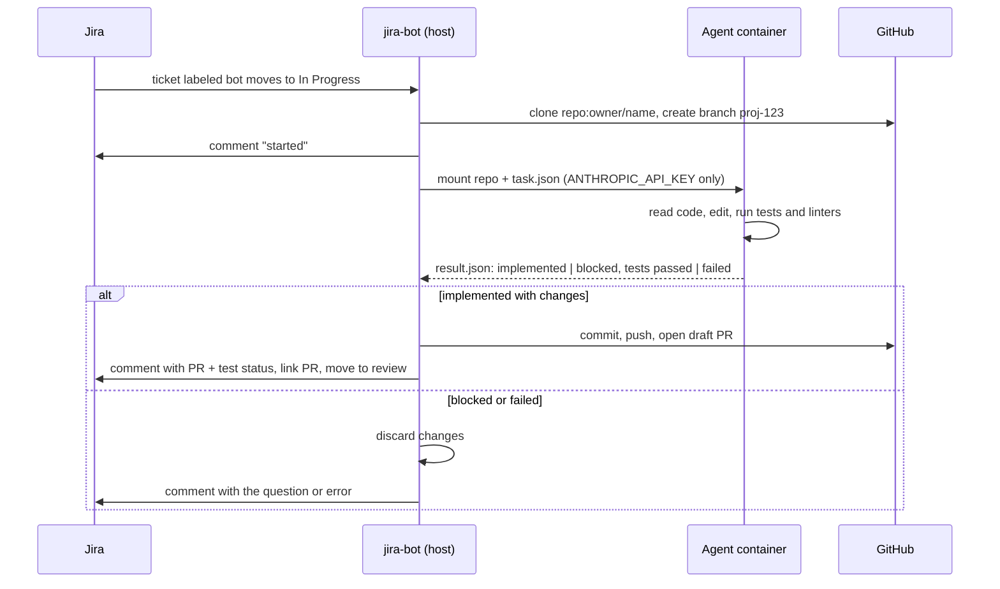

# jira-bot

Label a Jira ticket `bot`, move it to **In Progress**, and get a tested draft pull request back.

jira-bot watches Jira for opted-in tickets, hands each one to a Claude Agent SDK coding session inside a throwaway Docker container, and turns the result into a draft PR, a comment on the ticket, and a link from the ticket to the PR. Engineers write the ticket and review the change; the agent does the part in between.



**Status:** new. The pipeline is covered by unit tests and a container smoke test in CI; a public demo with real tickets and pull requests is in progress.

## Design

**The container is the trust boundary.** The agent runs shell commands chosen by a model reading ticket text that anyone with Jira access can write, so it gets nothing worth stealing. Only `ANTHROPIC_API_KEY` is passed in, by name so it never appears in the process list. Jira and GitHub credentials stay on the host, which does every commit, push, PR, and comment itself.

**The agent can't rewrite history.** A `PreToolUse` hook denies any git subcommand that isn't read-only (`commit`, `push`, `checkout`, `reset`, `stash`, `rebase`, ...), including inside `bash -c` and `git -C` forms. The branch stays in the state the host expects, and the agent is told why when a command is refused so it can carry on.

**No web access.** `WebFetch` and `WebSearch` are disabled. The only inputs are the ticket and the repository, which narrows what a prompt-injected ticket can pull in.

**Structured outcomes, not prose.** The session ends with JSON validated against a schema: `implemented` or `blocked`, a PR title and summary, and the test command with its result. A vague ticket produces a clarifying question on the ticket instead of a guessed implementation.

**Bounded cost.** Each run is capped by turns, dollars, wall-clock time, memory, and CPU. Tickets opt in with a label. Once the agent has run, the ticket is recorded as handled even if the run failed, so the watcher never repeats a paid run; `jira-bot run KEY` re-runs it on purpose. Every PR and ticket comment reports what the run cost.

**The repo's own conventions.** The agent loads the target repo's `CLAUDE.md` and `.claude/settings.json` and nothing from the host, and is told to match nearby code and add tests.

## Setup

### 1. Install on the host

```bash
git clone https://github.com/bradleypaul/jira-bot.git ~/jira-bot
cd ~/jira-bot
python3 -m venv .venv
source .venv/bin/activate
pip install -e .
```

### 2. Build the agent image

```bash
docker build -t jira-bot-agent .
```

The image is Node 22 with Python 3, git, and build tools, so the agent can install dependencies and run tests for Node and Python projects. For other stacks, extend it and set `JIRA_BOT_IMAGE`.

### 3. Configure

```bash
cp .env.example .env
```

| Variable | Description |
| --- | --- |
| `JIRA_BASE_URL` | e.g. `https://your-domain.atlassian.net` |
| `JIRA_EMAIL` | Email of the Jira account the bot acts as |
| `JIRA_API_TOKEN` | From https://id.atlassian.com/manage-profile/security/api-tokens |
| `ANTHROPIC_API_KEY` | Passed into the agent container |
| `GITHUB_TOKEN` | Opens pull requests. Optional if `gh auth login` has been run on the host |

The host pushes over the clone's remote, so it needs git credentials for the repo too (`gh auth setup-git`, a credential helper, or `JIRA_GIT_SSH=1` with a deploy key).

Optional tuning:

| Variable | Default | |
| --- | --- | --- |
| `JIRA_BOT_LABEL` | `bot` | Label a ticket needs before the watcher picks it up |
| `JIRA_BOT_MODEL` | `claude-opus-5-5` | |
| `JIRA_BOT_EFFORT` | `high` | |
| `JIRA_BOT_MAX_BUDGET_USD` | `10` | Hard cap per run |
| `JIRA_BOT_MAX_TURNS` | `100` | |
| `JIRA_BOT_TIMEOUT_MINUTES` | `45` | The container is killed after this |
| `JIRA_BOT_MEMORY` / `JIRA_BOT_CPUS` | `4g` / `2` | Container limits |
| `JIRA_BOT_IMAGE` | `jira-bot-agent:latest` | |
| `JIRA_BOT_REVIEW_TRANSITION` | `review` | Transition applied once a PR is open; empty to skip |
| `JIRA_BOT_GIT_NAME` / `JIRA_BOT_GIT_EMAIL` | git config | Committer identity |
| `JIRA_WORKSPACE` | `~/jira-repos` | Where repos are cloned |
| `JIRA_WATCH_INTERVAL` | `30` | Seconds between polls |
| `JIRA_WATCH_JQL` | assigned, In Progress, labeled `bot` | Replaces the default filter, label included |

### 4. Link a ticket to a repo

Give the ticket a label `repo:owner/name`, for example `repo:bradleypaul/jira-bot-demo`, plus the `bot` label.

### 5. Run one ticket

```bash
jira-bot whoami          # check Jira auth
jira-bot run PROJ-123
```

```
PROJ-123: implemented
  Pull request: https://github.com/owner/name/pull/7
  Logs: ~/.local/state/jira-bot/runs/PROJ-123-20261015T193000Z
```

Each run directory holds `task.json`, the agent's full tool-call log in `agent.log`, and `result.json`.

### 6. Watch for tickets

```bash
jira-bot watch
```

The first start records tickets that are already In Progress and leaves them alone. After that, each new opted-in ticket is run once. Handled keys are stored in `~/.local/state/jira-bot/seen.json`.

To keep it running on a Linux host with systemd (the service user needs access to Docker):

```bash
mkdir -p ~/.config/jira-bot ~/.config/systemd/user ~/jira-repos
cp deploy/env.example ~/.config/jira-bot/env      # then fill it in
cp deploy/jira-bot.service ~/.config/systemd/user/
sudo loginctl enable-linger "$USER"
systemctl --user daemon-reload
systemctl --user enable --now jira-bot
journalctl --user -u jira-bot -f
```

## Other commands

```bash
jira-bot issue PROJ-123
jira-bot comments PROJ-123
jira-bot search "project = PROJ AND status = 'In Progress'"
jira-bot transitions PROJ-123
jira-bot generate PROJ-123 --context "Python backend"   # implementation plan only, no changes
jira-bot start PROJ-123                                 # transition, clone, and branch only
```

Add `--json` before the command for machine-readable output. Everything is also importable:

```python
from jira_bot import JiraClient, generate_plan

client = JiraClient()  # reads JIRA_* from the environment or .env
plan = generate_plan(client, "PROJ-123")
```

jira-bot talks to Jira Cloud REST API v3 directly with an email and API token. It doesn't need the Atlassian CLI or a marketplace app, which site admins often disable.

## Development

```bash
pip install -e ".[dev]"
pytest
```

The tests cover every pipeline outcome, the git guard, and the container command without calling Jira, GitHub, Docker, or Claude. CI also builds the agent image.

## License

MIT
